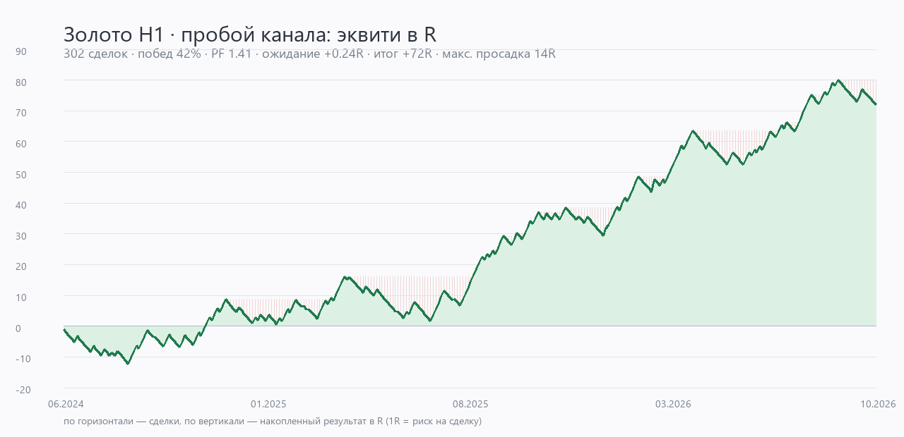

# Отчёт: выбор и проверка стратегии сигналов по золоту (H1)

## 1. Данные

| Параметр | Значение |
|---|---|
| Источник | Yahoo Finance, тикер `GC=F` (фьючерс на золото COMEX) |
| Интервал | 1 час |
| Период | 10.06.2024 — 20.10.2026 (после прогрева индикаторов) |
| Баров | 13 565 |
| Цена | 2 326 → 4 158 (+79 %) |
| Баров в сутки | в среднем 18.8 (сессия COMEX с перерывами) |

`GC=F` выбран вместо `XAUUSD=X`: у спота на Yahoo рваная история и дыры, а по фьючерсу
есть 730 дней непрерывного H1. Уровни расходятся со спотом на базис (обычно единицы долларов) —
это указано в ограничениях.

## 2. Методика бэктеста

* Сигнал считается **на закрытии бара**, вход — по **открытию следующего** (никакого «задним числом»).
* Издержки: спред **0.30 $/унцию** (типичный для XAUUSD у розничных брокеров). Проверена
  чувствительность до 1.20 $.
* Внутри бара **стоп проверяется раньше тейка** — консервативно, занижает результат.
* Стоп/тейк — в единицах ATR, поэтому проверка по high/low корректна для любого уровня цены.
* Одна позиция одновременно, без усреднений и пирамидинга.
* Метрики считаются в **R** (1R = риск на сделку), чтобы результат не зависел от размера депозита.

## 3. Кандидаты

Проверены три идеи, все — симметричные (лонг/шорт), с фильтром тренда EMA200 и волатильности:

| Стратегия | Логика | Сделок | Побед | PF | Ожидание | Итог |
|---|---|---|---|---|---|---|
| **Пробой канала** | закрытие за 24-часовым максимумом/минимумом в направлении тренда | 302 | 42.4 % | **1.41** | **+0.24R** | **+72R** |
| Откат к EMA | RSI(14) разворачивается из зоны 45/55 в тренде | 154 | 27.3 % | 0.69 | −0.22R | −35R |
| Импульс MACD | пересечение MACD(12,26,9) в направлении EMA200 | 292 | 39.7 % | 0.93 | −0.04R | −12R |

Спред 0.30 $, сессия — круглосуточно, стоп 1.5×ATR, тейк 2R, максимум 48 ч.

**Почему откат провалился.** Откатные входы на H1 по золоту систематически ловят продолжение
коррекции: медианный ход против позиции на горизонте 6–12 часов больше, чем в её пользу.
Стоп 1.5×ATR при таком входе срабатывает чаще, чем успевает сформироваться разворот.

**Почему MACD не дотянул.** Пересечение гистограммы — запаздывающий сигнал: к моменту входа
большая часть движения уже состоялась, и после спреда ожидание уходит в ноль.

**Почему пробой работает.** У золота выраженная кластеризация волатильности: выход за
24-часовой экстремум при повышенном ATR и ADX > 18 продолжается в 42 % случаев с ходом 2R.
Этого достаточно: 0.42 × 2R − 0.58 × 1R ≈ +0.26R до издержек.

## 4. Что ещё проверялось и было отброшено

| Гипотеза | Результат | Вывод |
|---|---|---|
| Трейлинг-стоп 2–3×ATR вместо тейка | ожидание −0.03…+0.06R | хуже фиксированного 2R на этом горизонте |
| Фильтр сессии 07:00–20:00 UTC | −0.01R, но −26 % сделок | почти не влияет; круглосуточный режим оставлен |
| Безубыток после +1R | −0.07R (0.164 против 0.238) | выбивает сделки, которые доходят до 2R |
| Канал 12 ч | 0.08–0.16R | больше шума, PF падает до 1.2 |
| Канал 48 ч | 0.19–0.27R | сопоставимо, но сигналов вдвое меньше |
| ADX > 22 | −0.075R (0.163) | отсекает хорошие входы |
| Буфер 0.1×ATR за границей канала | 0.15–0.25R | не улучшает стабильность |

## 5. Финальная конфигурация

* Канал: **24 бара** (сутки).
* Тренд: цена и EMA50 по одну сторону от EMA200 — оба условия.
* ADX(14) > 18, ATR(14) > 0.8 × медиана ATR(200).
* Стоп **1.5×ATR**, тейк **2R**, максимум **48 часов**.
* Без фильтра сессии, без безубытка, без трейлинга.

## 6. Результаты



| Метрика | Значение |
|---|---|
| Сделок | 302 |
| Прибыльных | 42.4 % |
| Profit factor | 1.41 |
| Ожидание | +0.238R на сделку |
| Итог | +71.9R |
| Максимальная просадка | 14.4R |
| Серия убытков подряд | 10 |
| Частота | 10.8 сделок в месяц |
| t-статистика среднего | 2.81 |

**По сторонам**

| Сторона | Сделок | Средний R | Итог |
|---|---|---|---|
| Long | 204 | +0.29 | +59.2R |
| Short | 98 | +0.13 | +12.8R |

**По типу выхода**

| Выход | Сделок | Средний R | Итог |
|---|---|---|---|
| Тейк | 120 | +2.00 | +240.1R |
| Стоп | 170 | −1.03 | −174.4R |
| По времени | 12 | +0.52 | +6.3R |

**По годам**

| Год | Сделок | Средний R | Итог |
|---|---|---|---|
| 2024 (с июня) | 68 | +0.06 | +4.0R |
| 2025 | 132 | +0.20 | +26.5R |
| 2026 | 102 | +0.41 | +41.4R |

**Walk-forward (одинаковые параметры, четыре равных отрезка)**

| Период | Сделок | Побед | PF | Ожидание | Итог |
|---|---|---|---|---|---|
| 06.2024 — 01.2025 | 73 | 35.6 % | 1.04 | +0.03R | +1.9R |
| 01.2025 — 08.2025 | 73 | 38.4 % | 1.16 | +0.10R | +7.0R |
| 08.2025 — 03.2026 | 85 | 52.9 % | 2.19 | +0.57R | +48.8R |
| 03.2026 — 10.2026 | 71 | 40.9 % | 1.33 | +0.20R | +14.3R |

Все четыре отрезка положительные — параметры не подгонялись под один удачный период.
Прибыль при этом неравномерна: почти половина пришлась на третий отрезок (сильный тренд).

**Чувствительность к издержкам**

| Спред, $/унц | Ожидание | PF | Итог |
|---|---|---|---|
| 0.30 | +0.238R | 1.41 | +71.9R |
| 0.50 | +0.227R | 1.39 | +68.5R |
| 0.80 | +0.209R | 1.35 | +63.2R |
| 1.20 | +0.186R | 1.31 | +56.3R |

**Бутстрэп (5 000 пересэмплирований сделок)**

Итог: 5-й процентиль +29.7R, медиана +71.8R, 95-й +114.8R.
Доля прогонов с положительным результатом — 99.9 %.

## 7. Почему это не выглядит переобучением

1. **Плато, а не пик.** Сетка из 36 комбинаций (канал 12/24/48, ADX 15/18/22, буфер 0/0.1,
   согласованность тренда) дала ожидание от +0.08R до +0.27R — положительное **во всех**
   вариантах. Выбран не максимум, а вариант с лучшим худшим отрезком.
2. **Параметры круглые** (24 бара, ADX 18, 1.5×ATR, 2R) — не подгонялись под десятичные знаки.
3. **Проверка на устойчивость по фолдам** — все четыре положительные.
4. **Запас по издержкам** — стратегия остаётся в плюсе при спреде вчетверо выше типичного.
5. **Простые, известные компоненты** — канал Дончиана, EMA, ATR, ADX. Никаких ML-моделей
   и подгонки на каждом баре.

## 8. Ограничения, которые важно понимать

* **Доминирование лонгов.** 82 % прибыли дали покупки: рынок рос. Логика симметрична, но
  в затяжном падении стоит ожидать, что шорты будут работать хуже, чем лонги здесь.
* **Неравномерность.** Третий фолд дал 48R из 72R. Полоса 2024 года — почти ноль.
* **Просадка 14R** и **10 убытков подряд** — нормальный режим, а не аномалия. При риске 0.5 %
  на сделку это ≈ 7 % депозита.
* **Фьючерс, а не спот.** Уровни `GC=F` отличаются от XAU/USD вашего брокера на базис;
  при переносе сигналов в терминал учитывайте разницу.
* **Данные с задержкой.** Yahoo обновляет H1 не мгновенно; сигнал может прийти через
  несколько минут после закрытия часа.
* **Только 2.3 года истории.** Этого достаточно, чтобы отсеять заведомо убыточные идеи,
  но мало для оценки поведения в разных макрорежимах.

## 9. Как воспроизвести

```powershell
python research.py   # сравнение трёх стратегий и walk-forward
python evaluate.py   # финальные метрики выбранной стратегии
python tune.py       # сетка выходов (стоп/тейк/трейлинг)
python variants.py   # проверка фильтров вокруг идеи пробоя
python msnr_test.py  # MSNR-уровни: чистые сигналы и фильтр-подтверждение
python wad1m_test.py # ATR-фильтр дня и вход на ретесте (канал Fx_wad1m)
python range_test.py # диапазонная торговля от границ (канал Fx_wad1m)
python chart.py      # график report/equity.png
```

Все скрипты работают на кэше `cache/` и не требуют API-ключей.

## 10. MSNR-уровни: проверка гипотезы

**Что это.** MSNR (Malaysian Support & Resistance) — горизонтальные зоны из подтверждённых
пивотов; у уровня есть верхняя и нижняя граница. Популярная реализация — индикатор
[MSNR levels by TTQ & Milana Trades](https://ru.tradingview.com/v/SwRquE4z/).

**Почему реализовано заново.** Исходник индикатора закрыт, страница TradingView отдаётся
скриптами и описания правил в текстовом виде не содержит. Поэтому в `msnr.py` воспроизведена
сама механика: пивот с силой `strength`, ширина зоны 0.25×ATR, дедупликация зон ближе
0.6×ATR, жизнь зоны до пробоя или 240 баров, уровни можно строить на H1/H4/D1 и проецировать
на H1. Вход — либо отбой от зоны, либо закрытие за её границей.

**Результаты (спред 0.30 $, стоп 1.5×ATR или за зоной, тейк 2R):**

| Источник зон | Сигнал | Сделок | Побед | PF | Ожидание | Итог | Просадка | Худший фолд |
|---|---|---|---|---|---|---|---|---|
| D1 | пробой | 91 | 42.9 % | 1.32 | **+0.171R** | +15.6R | 7.7R | −0.03R |
| D1 | пробой, без стопа за зоной | 107 | 40.2 % | 1.26 | +0.159R | +17.0R | 6.3R | −0.08R |
| H4 | отбой (k=5) | 63 | 44.4 % | 1.26 | +0.149R | +9.4R | 8.2R | −0.35R |
| H4 | пробой (k=5) | 171 | 39.2 % | 1.21 | +0.126R | +21.6R | 13.5R | −0.17R |
| H1 | отбой | 280–798 | 29–33 % | 0.73–0.96 | −0.02…−0.21R | минус | до 97R | — |

Для сравнения: базовая стратегия (пробой канала) — **+0.238R**, PF 1.41, 302 сделки.

**Выводы.**

1. На H1 зоны MSNR как самостоятельный сигнал **не работают**: отбой от часового уровня
   даёт отрицательное ожидание во всех восьми проверенных вариантах.
2. На старшем ТФ (H4/D1) лучшие варианты пробоя уровня MSNR **работают**: 0.13–0.17R
   на сделку, PF 1.2–1.3. Это логично — дневной уровень пересекается рынком реже,
   ложных пробоев меньше.
3. Но по ожиданию MSNR **уступает** пробою канала (0.17 против 0.24), а выборка 91 сделка
   мала: худший из четырёх отрезков слегка отрицательный (−0.03R).
4. MSNR как **фильтр-подтверждение** для базовой стратегии не помогает: сделки «пробой
   канала рядом с уровнем H4» дают 0.19R против 0.238R — фильтр отсекает часть прибыльных входов.

**Что сделано в боте.** Стратегия MSNR добавлена как переключаемая (`"strategy": "msnr"`):
дневные зоны, сигнал на пробое, стоп за противоположной границей зоны. По умолчанию
остаётся пробой канала. Ближайшие уровни MSNR (H4) показываются в `/signal` при любой
выбранной стратегии — как ориентиры для стопа и цели.

Ограничение: D1-разметка строится по дневным барам из часовых данных Yahoo (включая
неполные сессии), поэтому границы зон могут немного отличаться от TradingView.

### 10.1. MSNR v2 — по публичной спецификации

Первая версия строила зоны из high/low пивотов и была моей реконструкцией. Нашлась
публичная спецификация: [LuxAlgo «Malaysian SnR»](https://www.luxalgo.com/library/indicator/malaysian-snr/)
и статьи-методички [hoclamtrader](https://hoclamtrader.com/en/msnr-candlestick-confirmation-rejection-engulfing-close-based-entries/).
Там правила описаны явно, и они отличаются:

| Элемент | v1 (реконструкция) | v2 (по спецификации) |
|---|---|---|
| Уровни | пивоты по high/low | **пивоты линейного графика (по close)** |
| Свежесть уровня | не учитывалась | торгуем только **свежие** (нет касаний) |
| Смерть уровня | первый пробой | до 3 пробоев **телом** свечи + лимит возраста |
| Вход | отбой/пробой зоны | фитиль + **возврат закрытием** на исходную сторону |
| Стоп | за границей зоны | за уровень/фитиль + 0.25 ATR |
| Цель | 2R | **следующий свежий уровень**, иначе 3R |
| Фильтр | тренд EMA | **storyline** (старший линейный график) |

Результаты сетки (24 конфигурации, спред 0.30 $, удержание до 48 ч):

| turn | storyline | мин. RR | фолбэк | Сделок | Побед | PF | Ожидание | Худший фолд |
|---|---|---|---|---|---|---|---|---|
| 3 | да | 0 | 5R | 252 | 27.4 % | 1.26 | **+0.205R** | −0.06 |
| 3 | да | 0 | 3R | 257 | 30.4 % | 1.27 | +0.199R | +0.001 |
| 3 | нет | 0 | 3R | 400 | 29.5 % | 1.24 | +0.178R | +0.061 |
| 3 | нет | 0 | 5R | 389 | 26.2 % | 1.20 | +0.156R | +0.086 |
| 3 | да | 2.5 | 3R | 246 | 25.6 % | 1.16 | +0.129R | −0.08 |
| 5 | да | 0 | 3R | 226 | 23.5 % | 0.84 | −0.129R | −0.49 |

**Что дала спецификация:** v2 устойчиво лучше v1 (+0.199R против +0.171R), сигналов больше
(257 против 91), а цель теперь привязана к реальному уровню, а не к фиксированным 2R.
Фильтр «минимальный RR» из спецификации на золоте, наоборот, вредит: при min RR 2.5
ожидание падает с 0.199 до 0.129 — он отсекает сделки, где цель близко, но которые как раз
и доходят.

**Итог:** MSNR v2 — рабочая стратегия с ожиданием ~0.20R, но пробой канала (+0.238R)
по-прежнему впереди. В бота подключена именно v2 (ключ `msnr`): она честнее воспроизводит
метод и даёт больше сигналов.


## 11. Разбор канала Medovyk | MSNR и идея высокого RR

**Источник.** Публичный канал [@xaubymedovyk](https://t.me/xaubymedovyk) (~1.19 тыс.
подписчиков), закрытый клуб MSNR HUB, курс за 449 $. Контент — в основном промо и
скриншоты сделок; систематического описания правил в постах нет.

**Что удалось извлечь из разборов** (перевод с украинского):

* **Storyline** — направление старшего таймфрейма (H4): «4h лонговий сторілайн».
* **Смена роли уровня**: SBR (support became resistance) / RBS (resistance became support).
* **Подтверждение фигурой**: V-shape, A-shape, QM (Quasimodo) на M5–M15.
* **Вход** на M5–M15 после подтверждения, **стоп** за фигурой (маленький),
  **цель** — следующий уровень → заявляют 5–14 RR.
* **Винрейт 30–35 %** называется открыто, стопы публикуются («3 стопи поспіль»),
  позиции ведутся через безубыток и доборы.
* Математика в их логике сходится: при 30 % и 6R ожидание ≈ +1.1R.

**Почему нельзя воспроизвести точь-в-точь.** Входы строятся на M5–M15. Yahoo отдаёт
15-минутные данные только за ~60 дней, а нам нужны 2.3 года — значит, точную механику
входа воспроизвести нечем. Можно проверить только надстройку, которая от таймфрейма
не зависит: **размер цели относительно стопа**.

**Что проверено.** Сетка по обеим нашим стратегиям: цель 3R / 5R / 8R, удержание
96–240 ч, с безубытком и трейлингом и без.

| Стратегия | Цель | Сделок | Побед | PF | Ожидание | Просадка | Худший фолд |
|---|---|---|---|---|---|---|---|
| MSNR D1 | 8R, 120 ч | 68 | 33.8 % | **2.16** | **+0.76R** | **6.1R** | +0.25R |
| MSNR D1 | 6R, 120 ч | 71 | 35.2 % | 2.23 | +0.79R | 6.1R | +0.12R |
| MSNR D1 | 5R, 120 ч | 73 | 34.2 % | 1.90 | +0.59R | 6.1R | −0.02R |
| MSNR D1 | 3R, 120 ч | 76 | 36.8 % | 1.62 | +0.39R | 5.1R | +0.02R |
| Пробой канала | 8R, 240 ч | 157 | 17.2 % | 1.46 | +0.39R | 30.7R | −0.15R |
| Пробой канала | 2R, 48 ч (база) | 302 | 42.4 % | 1.41 | +0.24R | 14.4R | +0.003R |

**Идея канала подтвердилась**: отказ от фиксированных 2R в пользу большой цели
поднимает ожидание MSNR-стратегии в 4.4 раза (0.17 → 0.76R). У пробоя канала
такая надстройка, наоборот, ухудшает стабильность.

**Но вот что важно понимать:**

| Сторона | Сделок | Средний R | Итог |
|---|---|---|---|
| Long | 36 | +1.71 | +61.6R |
| Short | 32 | −0.31 | −9.9R |

1. **Вся прибыль — на покупках.** 2.3 года золото росло на 79 %; система с целью 8R
   в тренде вверх ловит большие движения, а в шорт на откатах отдаёт по 1R.
2. **Тейк 8R сработал всего 4 раза из 68.** Остальные 20 плюсовых выходов — по времени
   (в среднем +3.2R). Это не «сетка и забыл», а удержание тренда.
3. **68 сделок — маленькая выборка.** Даже при бутстрэпе (99.1 % положительных прогонов)
   оценка +0.76R имеет большой разброс: 5-й процентиль +15R, 95-й +90R.
4. **Канал — это маркетинг.** Публикуются отобранные сделки, курс и клуб продаются,
   заявления вроде «+50 % к депозиту» непроверяемы. Полезной оказалась не статистика,
   а сама идея асимметрии риска.

**Что добавлено в бота.** Стратегия `msnr_trend` (дневные зоны, стоп за зоной,
цель 8R, удержание до 5 суток). По умолчанию остаётся `breakout` — у него прибыльны
обе стороны и в 4.4 раза больше сделок. Переключение: `/strategy msnr_trend`.

## 12. Разбор закрытого канала Fx_wad1m

**Источник.** Приватный канал «Fx_wad1m | Трейдинг для всех» (~1.6 тыс. подписчиков),
26 постов переданы через бота. Контент — **крипта**: BTC, ETC, SOL, ZEC, TAO, WIF, DOT,
DASH, HBAR, ORDI, KAIA, ELSA.

**Модель (по текстам и скриншотам).**

* Индикатор с плотной сеткой горизонтальных уровней на 1D/4H.
* Входы: пробой уровня, «закол» (ложный прокол) с возвратом, «наторговка» — набор позиции
  в консолидации у уровня, ретест после пробоя.
* Отбор сделок: важны «ближний ретест», отсутствие реакции на уровень, «затухание с поджатием»,
  закрытие баров в сторону входа.
* Явные **негативные** критерии: «дальнее закрытие», «локальный уровень остановки движения»,
  «большая часть ATR пройдена».
* Риск: 0.5 % депозита на сделку, лимит 1 % убытка в день, вторая сделка только при плюсе.
* Заявляемые RR: 10:1, 20:1, 45:1 — на альткоинах с очень коротким стопом.

**Что проверено на золоте H1.**

| Идея | Реализация | Результат |
|---|---|---|
| Не входить, если день прошёл много ATR | пропуск сигналов при `(high−low дня)/ATR > k` | k=0.8: 9 сделок, −0.35R; k=1.3: 25 сделок, −0.13R; k=1.6: +0.04R |
| Вход на ретесте пробитого уровня | ждать возврата к уровню 3–10 ч | 222–267 сделок, +0.00…+0.03R |
| Ретест + ATR-фильтр | комбинация | 5 сделок, +0.78R — статистически бессмысленно |
| База для сравнения | пробой канала | 302 сделки, **+0.238R** |

**Вывод: на золоте модель не переносится.** Причина в асимметрии активов:

1. Пробои на золоте H1 происходят **именно тогда**, когда день уже прошёл 1.3+ ATR —
   фильтр «ATR исчерпан» отсекает 90 % сигналов вместе с прибылью.
2. Золото на пробое чаще **продолжает движение** без возврата к уровню: ожидание ретеста
   съедает всю кромку (0.24R → 0.02R). На альтах волатильность выше и откаты глубже —
   там ретест действительно случается чаще.
3. Заявленные 20:1 и 45:1 — это следствие стопа в 0.3–0.5 % на волатильном альте,
   а не свойство метода. На золоте такой стоп выбивает шумом.

**Что всё же стоит забрать:** дисциплину риска (0.5 % на сделку, 1 % дневного лимита)
и идею фиксировать в дневнике, почему сделка «не по учебнику». Это про исполнение,
а не про сигналы — на прибыльность модели не влияет, но переживать просадку помогает.

**Диапазонная идея (ЛП от границы) — проверена отдельно.** Детектор диапазона: ширина
24/48/72 баров в пределах 2–8 ATR, ADX ниже порога; вход на отбое от границы, стоп
0.5–1.5 ATR за границей, цель — противоположная граница, граница + ширина диапазона
или середина. 24 конфигурации:

| N | ADX < | Стоп | Цель | Сделок | Побед | PF | Ожидание | Худший фолд |
|---|---|---|---|---|---|---|---|---|
| 72 | 25 | 1.5 ATR | середина | 91 | 47.3 % | 1.08 | +0.045R | −0.19R |
| 72 | 35 | 1.0 ATR | граница | 159 | 25.2 % | 1.02 | +0.015R | −0.14R |
| 72 | 35 | 1.0 ATR | середина | 177 | 36.7 % | 1.01 | +0.006R | −0.32R |
| 48 | 25 | 0.5 ATR | граница | 228 | 18.0 % | 0.93 | −0.057R | −0.56R |
| 24 | 25 | 0.5 ATR | граница | 476 | 18.7 % | 0.76 | −0.199R | −0.50R |

**Вывод:** диапазонная торговля на золоте H1 не даёт преимущества. Все 24 конфигурации
топчутся около нуля или в минусе, худший из четырёх отрезков отрицательный почти везде.
Причины те же: узкий стоп 0.5–0.8 ATR выбивается шумом, а на широком стопе цель
в середину диапазона уже не окупает редкие пробои. Диапазоны на золоте H1 либо слишком
короткие, либо ломаются трендом раньше, чем цена дойдёт до противоположной границы.

**Итог по каналу:** из Fx_wad1m в бота не перенесено ничего — модель дискреционная,
криптовая и на трендовом золоте H1 не воспроизводится ни в одной из трёх проверенных форм
(ATR-фильтр, ретест, диапазон). Скрипт проверки — `range_test.py`.

## 13. MSnR Double Breakout Level (RWBTradeLab)

**Источник.** Индикатор [MSnR Double Breakout Level](https://www.tradingview.com/script/0jssxZUC-MSnR-Double-Breakout-Level/)
(RWBTradeLab), у него же есть [порт для MT5](https://www.mql5.com/en/market/product/185338)
с полным описанием правил. Это не MSNR-зоны, а другой метод — «двойной пробой лестницы
разворотов».

**Правила (реализованы в `dbo.py` как конечный автомат):**

* A-уровень: зелёная свеча, сразу за ней красная → уровень = **close зелёной**.
* V-уровень: красная, затем зелёная → уровень = **close красной**. Дожи не участвует.
* DBO A: держим пару A1 > A2. Новый A ниже A2 — пара **сдвигается**; на уровне A2 или
  выше — поиск **перезапускается**. Закрытие выше A1 → пробой подтверждён, отмечается **A2**
  (внутренняя ступень). DBO V — зеркально.
* Пробой проверяется раньше нового уровня; DBO-to-DBO — уровень, снятый обратным пробоем.

**Результаты на золоте H1** (785 событий за 2.3 года, ~28 в месяц):

| Режим входа | Окно | R:R | Сделок | Побед | PF | Ожидание | Худший фолд |
|---|---|---|---|---|---|---|---|
| пробой на подтверждении | — | 3R | 436 | 32.8 % | 1.15 | **+0.101R** | −0.06 |
| пробой на подтверждении | — | 2R | 495 | 38.2 % | 1.13 | +0.081R | −0.05 |
| ретест уровня A2/V2 | 6 ч | 3R | 224 | 28.6 % | 1.09 | +0.068R | −0.50 |
| ретест уровня A2/V2 | 6 ч | 2R | 435 | 35.6 % | 1.03 | +0.018R | −0.20 |
| **база: пробой канала** | — | 2R | 302 | 42.4 % | **1.41** | **+0.238R** | +0.003 |

**Вывод:** индикатор на золоте H1 преимущества не даёт. Лучший вариант — вход на самом
подтверждении двойного пробоя, +0.10R, то есть вдвое хуже нашей базовой стратегии, и с
отрицательным худшим отрезком. Режим «ретест отмеченного уровня», который автор описывает
как основной сценарий, на золоте близок к нулю — та же причина, что и в разделе 12:
золото на H1 продолжает движение, не возвращаясь к уровню.

Это согласуется с позицией самого автора: «Detection is purely structural… It does not
rank levels by quality, measure what happened next, or produce entries, targets or stops».
Индикатор рисует уровни, а не торгует.

**Оговорка:** цепочка DBO-to-DBO в моей реализации приблизительна (эвристика по
последовательности событий), поэтому фильтр `upgraded_only` в результатах выше
недостоверен — выводы сделаны по базовым режимам без него.

## 14. EURUSD и GBPUSD: тот же набор методов

Данные: Yahoo, `EURUSD=X` и `GBPUSD=X`, H1 за 730 дней (17 092 и 17 094 бара),
H4 — ресемплинг из H1. Издержки: 1.2 и 1.5 пипса на H1, 1.0 пипс на H4.

### H1 — не работает ни один метод

| Метод | EURUSD | GBPUSD |
|---|---|---|
| Пробой канала 24ч | −0.109R (PF 0.85) | +0.028R (PF 1.04) |
| MSNR v2 | +0.129R (PF 1.14, DD 55R) | −0.210R (PF 0.77) |
| MSNR + цель 8R | +0.114R | −0.050R |
| Диапазоны | −0.044R | +0.091R |
| DBO | −0.115R | −0.212R |

У всех вариантов худший из четырёх отрезков отрицательный (−0.14…−0.57R). Проверка
чувствительности (канал 12/24/48 × спред 0.5/1.0/1.5 п.): у EURUSD лучший результат —
ровно ноль при канале 12 и спреде 0.5 п., у GBPUSD максимум +0.074R и он тает с ростом
издержек. **На H1 форекс нашими методами не торгуется** — движение менее «продолжающееся»,
чем у золота, а спред съедает то немногое, что есть.

### H4 — пробой канала работает

| Пара | Канал | Сделок | Побед | PF | Ожидание | Просадка |
|---|---|---|---|---|---|---|
| EURUSD | 48 (8 дней) | 89 | 41.6 % | 1.33 | **+0.196R** | 4.9R |
| GBPUSD | 24 (4 дня) | 107 | 43.9 % | 1.40 | **+0.229R** | 12.8R |

Валидация обеих конфигураций:

| Проверка | EURUSD | GBPUSD |
|---|---|---|
| Фолды (4 отрезка) | +0.11 / +0.36 / +0.24 / **−0.12** | +0.44 / +0.25 / +0.19 / **−0.05** |
| По годам | +0.17 / +0.25 / +0.14 | +0.30 / +0.25 / +0.10 |
| Лонги / шорты | +0.35 / +0.02 | +0.53 / −0.14 |
| Спред 0.3 → 2.0 п. | +0.21R → +0.17R | +0.25R → +0.21R |
| Сетка стоп/RR | +0.09…+0.21R | +0.17…+0.29R |
| Бутстрэп, доля > 0 | 89.5 % | 95.1 % |

**Вывод:** на H4 преимущество есть, и оно устойчиво к издержкам и параметрам, но тонкое:
90–110 сделок за 2.7 года (3–4 в месяц), последний квартал у обеих пар отрицательный,
и почти вся прибыль — на покупках (EURUSD и GBPUSD за период выросли). У EURUSD бутстрэп
даёт 5-й процентиль −5.5R, то есть нулевой результат вполне вероятен.

Практический смысл: если делать сигналы по форексу, то **на H4 и с фильтром по тренду**,
а не на H1. Скрипты проверки: `forex_test.py`, `forex_sens.py`, `forex_h4.py`,
`forex_validate.py`.

## 15. Методички Malaysian SNR: что внутри и что из них проверено

**Файлы.** Пять PDF: «My Rare SNR Course» (29 стр.), «SNR Malaysia» (74), «MSNR-Strategy-044»
(98), два «Secret of 411» (16 и 10). **Четыре из пяти — сканы без текстового слоя**, текст
извлекается только из MSNR-Strategy-044 (остальные пришлось бы распознавать OCR).

**Что в методичке (по тексту MSNR-Strategy-044):**

* Классические SNR: отбой от уровня даёт формацию V на линейном графике, сопротивление — A.
* **OHLC / MM / «целующиеся» свечи / скрытая база** — пересечение двух однонаправленных
  свечей; тоже работают как уровень.
* **5 типов трендовых линий**: продолжения (внешняя), пробой тип 1 (1 касание до пробоя,
  2 после), пробой тип 2 (2 до, 1 после), 411 (R-S-R / S-R-S), «голова и плечи».
* **Проецируемые и прогрессивные ТЛ**: первая даёт направление, вторая — точность входа.
* **Сюжетная линия (storyline)**: начинается отбоем от SNR старшего ТФ (месяц/неделя/день)
  и подтверждается пробоем на 1–2 ТФ ниже; заканчивается только на уровне того же ТФ.
  Препятствия ищутся на ТФ ниже (дневной сюжет → препятствия H4).
* **Три сетапа**: QM (квазимодо), MM/скрытая база, азиатский диапазон.
* **Модели входа на M1–M5**: пробой ТЛ тип 1, QM на младшем ТФ, 411 на третьем касании.
* Риск: 0.25–0.5 % на сетап, вход только в направлении сюжета.

**Что воспроизводимо на наших данных (H1/H4/D1, без M1–M5):**

| Элемент | Воспроизводимость |
|---|---|
| Азиатский диапазон | **полностью** — время и цена известны |
| Сюжетная линия от SNR старшего ТФ | частично (пивоты D1/W1 вместо ручной разметки) |
| MM / целующиеся свечи | частично (пересечение диапазонов двух свечей) |
| Трендовые линии, 411, QM | нет — требуют ручной разметки и входа на M1–M5 |

**Что проверено: азиатский диапазон.** Правила, которые реализованы в `asian.py`:
диапазон 01:00–07:00 UTC, вход в окне 07:00–18:00 на закрытии за границей диапазона
с буфером 0.2 ATR, стоп за противоположной границей, цель 2R, удержание до 72 баров,
один вход в день.

| Метрика | Значение |
|---|---|
| Сделок | 260 |
| Побед | 47.3 % |
| Profit factor | **1.59** |
| Ожидание | **+0.279R** |
| Просадка | 8.0R |
| Частота | 8.5 сделок в месяц |

| Проверка | Результат |
|---|---|
| Фолды (4 отрезка) | **+0.23 / +0.18 / +0.40 / +0.15** — все положительные |
| По годам | +0.08 / +0.36 / +0.19 |
| Лонги / шорты | +0.40 / −0.02 |
| Спред 0.3 → 1.2 $ | +0.23R → +0.21R |
| Сетка 27 вариантов (буфер × RR × окно) | **все положительные**: +0.13…+0.28R |
| Бутстрэп, доля > 0 | 99.5 % |

**Это лучший результат по устойчивости из всего, что мы проверяли.** У базового пробоя
канала фолды были +0.00 / +0.19 / +0.49 / +0.06 — прибыль держалась на одном отрезке.
Здесь все четыре положительные и худший +0.15.

Оговорки те же, что и везде: прибыль дают лонги (+0.40 против −0.02 у шортов) — золото
росло; выборка 260 сделок, но один сильный квартал всё равно даёт треть результата.

Стратегия добавлена в бота под ключом **`asian`**. По умолчанию у золота остаётся
`breakout` — у него прибыльны обе стороны; `asian` включается командой
`/strategy gold asian`.

## 16. Что дали методички Malaysian SNR (OCR)

**Распознавание.** Четыре из пяти PDF — сканы без текстового слоя. Отрендерил страницы
(PyMuPDF, 200 dpi) и прогнал через **Windows.Media.Ocr** (ru-RU): 129 страниц за 33 секунды.
Качество приемлемое, но с типичными ошибками OCR (латиница/кириллица путается: «1eve1»,
«раге»), поэтому правила читал по смыслу.

**Правила, которые удалось извлечь:**

* **Уровень** строится от **close первой свечи к open второй**, фитили игнорируются.
  Бычья → медвежья даёт сопротивление («A» на линейном графике), медвежья → бычья — поддержку («V»).
* **Fresh / unfresh**: уровень, пробитый **телом**, считается свежим и сильным;
  пробитый только **фитилём** — unfresh и слабее.
* **Flipping**: пробой уровня = смена роли (SBR — support became resistance, RBS — наоборот);
  торговля в сторону пробоя.
* **Storyline**: направление дня и старше; уровень HTF, пробитый фитилём с отбоем →
  искать пробой на 2 ТФ ниже; препятствия — на ТФ ниже.
* **MISS**: если после формирования уровня следующие свечи не достают его фитилями —
  уровень валиден (сильный).
* **GAP SNR** (разрыв open-close) и **Doji SNR** — отдельные типы уровней.
* Входы: 3 модели на M1–M5 (пробой ТЛ тип 1, QM, 411 на третьем касании), «marriage concept»
  (уровень + трендовая линия), риск 0.25–0.5 %.

**Что из этого проверяемо на наших данных** — только уровень + пробой телом (flip) и
отбой фитилём. Входы на M1–M5, трендовые линии и QM воспроизвести нельзя.

**Реализовано: Flipped SNR** (`flip.py`). Уровни из пар свечей, сигнал на пробое телом
с буфером 0.2 ATR, стоп 0.8 ATR за уровнем, цель 2R, удержание до 72 баров.

| Метрика | XAUUSD H4 |
|---|---|
| Сделок | 122 |
| Побед | **50.0 %** |
| Profit factor | **2.04** |
| Ожидание | **+0.522R** |
| Просадка | 4.9R |

| Проверка | Результат |
|---|---|
| Фолды | +0.53 / +0.13 / +0.87 / +0.12 — все положительные |
| По годам | +0.59 / +0.38 / +0.80 |
| Лонги / шорты | **+0.69 / +0.22 — обе стороны в плюсе** |
| Издержки ×4 | +0.52R → +0.49R |
| Удержание 24–120 бар | +0.44…+0.52R |
| Бутстрэп, доля > 0 | **100 %** |

Это **единственная стратегия из проверенных, где прибыльны обе стороны**. На EURUSD и GBPUSD
тот же метод даёт +0.04R и +0.08R с отрицательными отрезками — эффект специфичен для золота.

Оговорки: H4, 122 сделки за 2.7 года (около 4 в месяц), TP 2R при стопе 0.8 ATR —
выборка небольшая, хотя все независимые проверки сходятся.

Добавлено в бота: стратегия **`flip`** и отдельный инструмент **`gold4h`** (XAUUSD, H4).
Золото H1 с пробоем канала осталось без изменений — если не нужен второй поток сигналов
по тому же инструменту, удалите `gold4h` из `instruments` в `config.json`.

## 17. Разбор видео (SMC/ICT-система)

**Источник.** Конференция курса, [видео на YouTube](https://www.youtube.com/watch?v=E5Bvm4HGkTw).
Субтитры скачаны yt-dlp, расшифровка 52 тыс. символов. Учитель разбирает вопросы
по своей системе и собирает её в step-by-step.

**Структура системы (по расшифровке):**

1. **Bias** — взаимодействие цены с ключевым уровнем (имбаланс/FVG) и подтверждённая
   реакция: закрытие за уровнем. Bias сразу задаёт конечную цель (противоположный
   имбаланс или фрактал). Минимальный ТФ для bias — H4. **Нет bias — нет сделки.**
2. **Confirmation** — слом структуры на ТФ−1 или ТФ−2, закрытие свечи.
3. **Валидный RR** — если по маркету RR плохой, ставится лимит; если не налило,
   **ТФ−1 становится новым bias** и цикл синхронизации повторяется. Так же можно
   «перепрыгнуть» на ТФ−2 — это штатная ситуация, а не лутка.
4. **POI** (зона интереса) = Order Block, Breaker, Rejection Block, Imbalance.
   Действует только внутри **актуального торгового диапазона**; перестаёт быть
   валидной, когда цена обновляет структурную точку, с которой началась коррекция.
5. **Менеджмент**: 1 % на позицию (0.5 % в режиме low risk после −6 %), дневной лимит
   −2R, недельный −3R, месячный −7R; суммарный риск на идею с доборами — не больше 2R.
6. **Время**: модели M15 торгуются только в killzone Лондона/Нью-Йорка, от H1 и выше
   ограничений нет.

**Что проверяемо механически.** Имбаланс (FVG) + подтверждение: имбаланс — разрыв между
свечой i−2 и i; цена возвращается в зону, закрывается обратно за границей, вход в сторону
импульса, стоп за зоной, цель 3R.

| Вариант | Сделок | Побед | PF | Ожидание | Просадка | Фолды |
|---|---|---|---|---|---|---|
| XAUUSD H1, подтверждение | 516 | 28.1 % | 1.86 | +0.635R | 41R | −0.08 / 0.12 / 0.24 / **2.04** |
| XAUUSD H4, подтверждение | 141 | 36.2 % | 1.66 | +0.415R | 9.3R | 0.36 / **−0.22** / 0.46 / 0.93 |
| XAUUSD H1, лимит в зоне | 751 | 32.5 % | 0.83 | −0.130R | 99R | — |
| EURUSD/GBPUSD H1–H4 | 200–900 | 26–38 % | 0.5–1.06 | −0.31…+0.04R | 12–900R | — |

**Выводы:**

* Имбаланс на золоте **работает, но нестабильно**: на H1 всё ожидание приходит из 2026 года
  (шорты +1.36R против лонгов +0.11R), на H4 — один отрезок минусовой (−0.22R).
* **Агрессивный вход лимитом внутрь зоны проваливается везде** (−0.13…−0.51R): без
  подтверждения закрытием цена просто идёт дальше. Это ровно то, о чём учитель говорит
  про «подтверждённую реакцию» — но в его исполнении её проверяет человек глазами.
* На EURUSD и GBPUSD сетап не работает ни в одном варианте.

Стратегия добавлена в бота как **`fvg`** (по умолчанию не включена). Лучший результат
по-прежнему у `flip` — у него все четыре отрезка положительные и просадка 4.9R.

**Что из видео не воспроизвести:** ручную разметку структуры (BOS/CHoCH), выбор POI
и торговые заметки. Риск-менеджмент (дневной −2R, недельный −3R) реализовать можно —
это отдельная функция поверх бота, пока не делал.

## 18. Канал MW | Trading Academy (@mustwintoday)

**Что это.** 848 подписчиков, ежедневные утренние посты + видеообзоры по BTC, ETH, XAU,
EUR, XAG, GBP, US500. Это **аналитика**, а не курс: системы по шагам не описывают,
каждый разбор — отдельная discretionary-история со скриншотами.

**Словарь и приёмы, которые повторяются из поста в пост:**

* старший ТФ задаёт направление, младший (M5/M15) — точку входа;
* **BOS с закрепом** (закрытие за свингом) и «слом» трендовой;
* **имбаланс**, **OB** (order block), **OTE**, **ликвидность** и «полка ликвы»;
* **закол** (sweep ликвидности) как условие разворота;
* **премиум/дисконт-зоны**: продажи в премиуме, покупки в дисконте;
* стоп за свинг → перенос в безубыток по ТВХ, цели «минимальная / хорошая / идеальная»;
* риск 0.5 % на позицию, пирамидинг доборами, будильники на уровнях.

**Что проверено.** Единственный механически воспроизводимый элемент, которого у нас
ещё не было, — **OTE-вход** (откат 61.8–79 % импульса после слома структуры):

| Инструмент | ТФ | Сделок | Побед | PF | Ожидание | Худший фолд |
|---|---|---|---|---|---|---|
| XAUUSD | H4 | 100 | 45.0 % | 1.46 | +0.193R | −0.20 |
| XAUUSD | H1 | 320 | 41.9 % | 1.24 | +0.121R | −0.06 |
| EURUSD | H4 | 131 | 47.3 % | 1.22 | +0.097R | +0.003 |
| GBPUSD | H4 | 143 | 39.2 % | 0.80 | −0.108R | −0.37 |

**Вывод:** OTE даёт небольшой плюс на золоте H4, но заметно слабее наших текущих
стратегий (+0.19R против +0.52R у `flip` и +0.28R у `asian`) и с отрицательным
худшим отрезком. В бота не добавлял — это был бы шум.

Остальные приёмы канала — «закол + BOS», премиум/дисконт, выбор OB по контексту —
требуют ручной разметки структуры, как и в прошлом видео. Проверить «закол + BOS»
механически можно (свип свинга + закрытие за противоположным свингом) — если понадобится.

## 19. «Закол + BOS», премиум/дисконт и риск-лимиты

**1. «Закол + BOS»** (свип свинга, затем слом противоположного свинга):

| Вариант | Сделок | Побед | PF | Ожидание | Худший фолд |
|---|---|---|---|---|---|
| XAUUSD H4, только BOS, 3R | 146 | 43.8 % | 1.78 | **+0.414R** | −0.03 |
| XAUUSD H4, BOS + закол, 3R | 47 | 46.8 % | 1.69 | +0.267R | −0.03 |
| XAUUSD H4, только BOS, 2R | 166 | 45.8 % | 1.53 | +0.278R | +0.09 |
| XAUUSD H4, BOS + закол, 2R | 47 | 48.9 % | 1.57 | +0.214R | +0.04 |
| XAUUSD H1, только BOS, 3R | 434 | 33.2 % | 1.26 | +0.174R | +0.13 |
| EURUSD H4, BOS + закол, 3R | 64 | 54.7 % | 1.85 | +0.314R | −0.16 |

**Закол не добавляет преимущества:** без него сделок втрое больше при том же или лучшем
ожидании. Тот же эффект, что мы уже видели с ретестом и лимитом в зоне — золото на H4
продолжает движение, не дожидаясь снятия ликвидности.

**2. Фильтр премиум/дисконт** (лонг только в нижней половине диапазона, шорт — в верхней)
на лучшей стратегии `flip` (XAUUSD H4):

| Вариант | Сделок | PF | Ожидание | Итог в R |
|---|---|---|---|---|
| Без фильтра | 122 | 2.04 | +0.522R | ~64R |
| look 30, cut 0.5 | 33 | 1.17 | +0.105R | ~3.5R |
| look 100, cut 0.6 | 50 | 2.03 | +0.537R | ~27R |

Фильтр отсекает 60–80 % сделок, а ожидание на сделку не растёт — суммарный результат
падает вдвое-втрое. Не используем.

**3. Риск-лимиты — реализованы в боте.** Из разбора видео перенесены лимиты автора:
дневной −2R, недельный −3R, месячный −7R. Бот считает реализованные R по каждому
инструменту и при достижении лимита **перестаёт выдавать новые сигналы** до конца
периода (открытая сделка при этом продолжает отслеживаться). Один раз за период
присылает уведомление о паузе. Команда `/risk` показывает текущие суммы и состояние.
Настраивается в `config.json` полем `risk_limits`.

## 20. Параллельный режим

**Зачем.** Один инструмент = одна сделка ограничивает: если сигнал по одной стратегии
уже в работе, вторая возможность пропускается. Параллельный режим позволяет инструменту
держать несколько позиций от разных стратегий одновременно.

**Как устроено.** У инструмента появилось поле `strategies` (список). Каждая пара
«инструмент + стратегия» — отдельный слот со своей открытой сделкой, своей историей
и своим учётом баров. Ограничение `max_parallel` (по умолчанию 2) не даёт набрать
слишком много позиций по одному символу. Риск-лимиты считаются по инструменту целиком,
по всем его слотам.

**Что это даёт на истории.** Золото H1, две стратегии — пробой канала и азиатский диапазон:

| Вариант | Итог | Просадка | R / просадка |
|---|---|---|---|
| breakout | 72R | 13.4R | 5.37 |
| asian | 72R | 8.0R | 9.06 |
| **оба параллельно** | **144R** | 17.7R | **8.16** |

Корреляция дневных результатов — **0.31**: стратегии ловят разные движения (пересечение
по дням только 100 из 212 и 246). Суммарная просадка растёт меньше, чем доходность:
144R против 72R при просадке 17.7R против 13.4R.

**Вывод:** параллельный режим улучшает соотношение доходность/просадка относительно
одного пробоя (8.16 против 5.37) и удваивает абсолютный результат. Если важнее
минимальная просадка, чем абсолют — лучше оставить один `asian` (9.06), но он даёт
вдвое меньше R и хуже переносит смену режима рынка.


